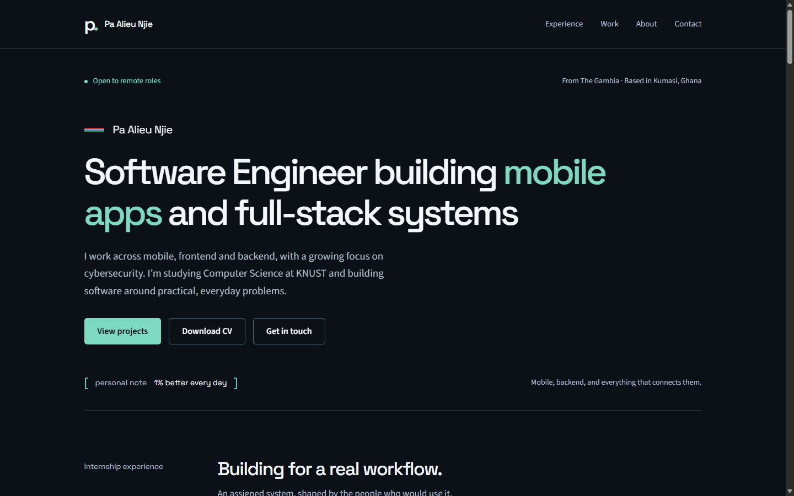

# Pa Alieu Njie — portfolio

A text-first portfolio for remote Software Engineer / Full-Stack Developer roles, with a printable web CV at `/cv` and a downloadable PDF.



## Tech stack

- **Next.js 16** (App Router, statically rendered) and **React 19**
- **TypeScript**
- **Tailwind CSS 3** with PostCSS and Autoprefixer
- **Space Grotesk** and **Source Sans 3**, served locally through Fontsource (no third-party font requests)
- Production Content Security Policy with hashed inline scripts, plus X-Frame-Options, Referrer-Policy and Permissions-Policy headers

## Run locally

Use Node.js 22 or later and npm. In PowerShell:

```powershell
git clone https://github.com/Pa-Alieu25/portfolio.git
cd portfolio
npm install
npm run dev
```

Open **http://127.0.0.1:3000**. The dev server binds to loopback only.

Production preview:

```powershell
npm run build
npm start
```

Always build with `npm run build`, not `next build`. The build script checks public content first, then builds Next.js, then adds hashes of the generated inline scripts to the production CSP.

## Editing content

All public content lives in **`src/data/profile.ts`**. Components only read from it.

| Field | What it controls |
|---|---|
| `name`, `headline`, `hero` | Header, hero headline, introduction, location and availability |
| `contact` | Email, GitHub and LinkedIn links |
| `cv` | The **Download CV** button (`href` points to the PDF in `public/`) |
| `siteUrl` | Real deployed origin. Enables the canonical URL, absolute sitemap entry and the site link on the web CV. Leave `null` until the live URL is known |
| `seo` | Page title, meta description and Open Graph image text |
| `navigation` and section data | Experience, projects, skills, leadership, learning and about sections |
| `resume` | Wording, labels and sections for the `/cv` page |

After editing, run the checks below. Changes to the CV wording also require a new, re-verified PDF export. `npm run check:public` only accepts the approved `public/Pa_Alieu_Njie_CV.pdf`, pinned by its SHA-256 hash in `scripts/check-public.mjs`.

## Checks

```powershell
npm run typecheck
npm run check:public
npm run build
```

`check:public` blocks phone numbers, credentials, `.env`/key files, unapproved GitHub links and any PDF other than the approved public CV.

## Privacy

- The website and public CV PDF contain no phone number. The application CV with private contact details is kept outside this repository.
- No private project source, restricted repository links or company data.
